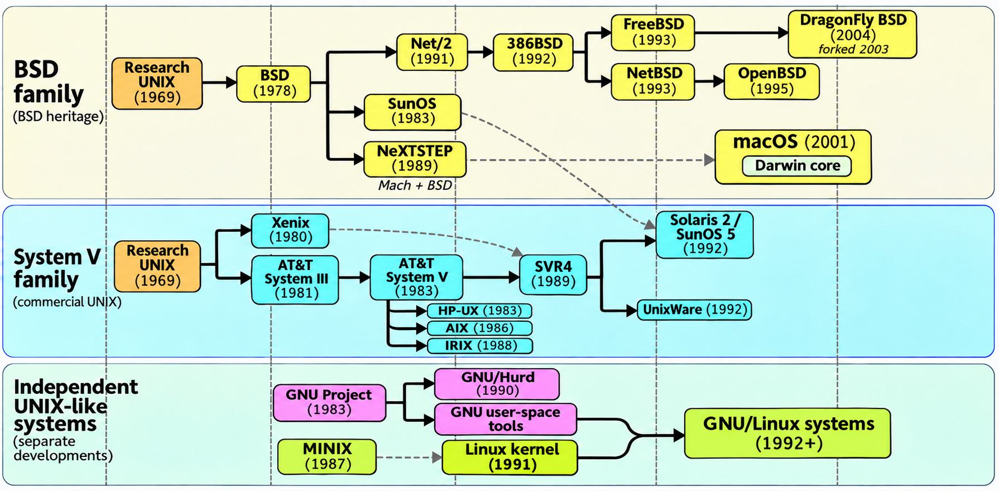

# UNIX

UNIX is a multi-user, multi-tasking operating system originally developed in 1969 at AT&T Bell Labs by Ken Thompson, Dennis Ritchie, and others. It allows multiple users to work on the same system simultaneously, each running multiple programs at once. UNIX is known for its portability, modular design, and command-line interface, making it popular in servers, workstations, and embedded systems.

## UNIX Versions

| Version | Year | Key Features |
|---------|------|--------------|
| V1      | 1971 | First official release; written in PDP-11 (a DEC minicomputer) assembly language; had 34 system calls. |
| V2      | 1972 | Support for PDP-11/45 memory management; included the first C compiler. |
| V3      | 1973 | Introduced pipes, `yacc` parser generator, and a C debugger. Last version with an assembly kernel. |
| V4      | 1973 | Kernel rewritten in C, making UNIX portable; introduced the `grep` command. |
| V5      | 1974 | Licensed to educational institutions; first version available outside Bell Labs. |
| V6      | 1975 | First version widely available outside Bell Labs, including commercial users; basis for Lions' Commentary. |
| V7      | 1979 | Last widely distributed research UNIX; introduced Bourne shell, `awk`, and C programming tools. |
| V8      | 1985 | Added STREAMS for advanced I/O, graphics support, and early networking features. |
| V9      | 1986 | Focused on networking, graphics enhancements, and new system utilities. |
| V10     | 1989 | Final research version; improved streams, C++ compiler support, and ANSI C libraries. |

Versions 8, 9, and 10 were primarily used for research at Bell Labs and were not widely distributed. They focused on experimental features, networking, and programming tools, many of which eventually migrated into other UNIX-like systems, including Linux and BSD.

UNIX V10, released in 1989, was the last research version developed at Bell Labs. By that time, many of the same researchers — including Ken Thompson, Dennis Ritchie, and Rob Pike — had already begun work on successor systems:

- **Plan 9** (started mid-1980s, first public release 1992) — designed to take UNIX's "everything is a file" philosophy further, with a focus on distributed systems and network-transparent resource sharing.

- **Inferno** (1996) — built on Plan 9's concepts, designed for portability across embedded systems, set-top boxes, and networked devices.

Neither Plan 9 nor Inferno achieved widespread adoption, but their ideas influenced later systems, including Linux and Golang.

However, UNIX itself had a far greater impact. Because AT&T shared its source code with universities and vendors, UNIX spawned an entire family of operating systems — BSD, System V, Solaris, AIX, Linux, macOS, and many others — that dominate computing to this day.

## UNIX Timeline

The timeline below shows how that single operating system created at Bell Labs in 1969 branched into this family over the following decades.

### How UNIX Branched

Under a 1956 consent decree — a legal agreement settling an antitrust case — AT&T was barred from selling products outside the telephone business. As a result, Bell Labs could not sell UNIX. Instead, it shared the source code with universities for a nominal fee. This openness allowed researchers, particularly at the University of California, Berkeley, to study, modify, and extend the system.

By the late 1970s, two distinct lineages had emerged:

- **BSD** (Berkeley Software Distribution) — the academic branch. Berkeley added virtual memory, the C shell, `vi`, and — most significantly — the TCP/IP networking stack that would become the foundation of the Internet.

- **System V** — the commercial branch. AT&T began commercializing UNIX with System III (1981) and System V (1983). After the breakup of the Bell System in 1984 lifted the remaining restrictions, AT&T aggressively marketed System V as the industry standard. It became the basis for commercial offerings from IBM (AIX), HP (HP-UX), and others.

A third branch, **Xenix**, was created by Microsoft in 1980 as a UNIX variant for microcomputers. The Santa Cruz Operation (SCO) later became its primary developer and distributor. Xenix was the most widely installed UNIX of the 1980s but was eventually folded into System V Release 4.

### The UNIX Wars (1987–1993)

By the mid-1980s, over 250 incompatible versions of UNIX existed across different vendors. In 1987, AT&T and Sun Microsystems announced a partnership to unify the major branches into a single system — System V Release 4 (SVR4). Fearing this would give AT&T and Sun an unfair advantage, rival vendors including IBM, DEC, and HP formed the **Open Software Foundation (OSF)**. AT&T and Sun responded by creating **UNIX International (UI)**.

The resulting "UNIX Wars" divided the industry into two camps, each promoting its own standard and implementation. The conflict ended in the early 1990s when AT&T sold its UNIX business to Novell (1993), and the rival factions dissolved.

### The UNIX Trademark Today

In 1993, Novell transferred the UNIX trademark to the vendor-neutral consortium **X/Open** (later **The Open Group**), separating the brand from any single company's code. The Open Group introduced the **Single UNIX Specification (SUS)** — a set of standards that any operating system must pass (over 40,000 conformance tests) to legally use the name "UNIX." Today, certified UNIX systems include Solaris, HP-UX, AIX, and macOS.

### POSIX

**POSIX** (Portable Operating System Interface) is a family of standards defined by the **IEEE** (Institute of Electrical and Electronics Engineers) that specifies how a UNIX-like operating system should behave. It covers the system call interface, shell commands, utility programs, and other aspects of the operating environment — so that software written for one POSIX-compliant system can be compiled and run on another with minimal changes.

POSIX emerged in the late 1980s (IEEE Std 1003.1, first published in 1988) as a direct response to the fragmentation of the UNIX Wars era. With hundreds of incompatible UNIX variants, the industry needed a common interface specification that was independent of any vendor's implementation.

POSIX and SUS are closely related: the **Single UNIX Specification** incorporates POSIX as its core and adds additional requirements. An operating system can be POSIX-compliant without being a certified UNIX (e.g., Linux, MINIX), but every certified UNIX system must also conform to POSIX.

### UNIX-Like Systems

Not all systems in the UNIX family use original AT&T source code. **GNU/Linux** and **MINIX** are UNIX-like operating systems — they follow UNIX design principles and provide POSIX-compatible interfaces, but were written from scratch without any AT&T code. This is why they appear with dotted lines in the timeline above.

## Berkeley Software Distribution (BSD)

BSD originated at the University of California, Berkeley in 1978 as a set of add-on tools for AT&T's UNIX — initially the `ex` editor and a Pascal compiler, followed by the `vi` editor and C shell (`csh`) in 1979 — distributed to other universities on tape. Over time, it evolved from a collection of patches into a complete, standalone operating system.

Funded by DARPA (the U.S. Defense Advanced Research Projects Agency), Berkeley developers made contributions that shaped modern computing, including virtual memory, the Berkeley Fast File System (FFS), and the TCP/IP networking stack. These advancements made BSD the operating system of choice for engineering workstations throughout the 1980s.

| Version      | Year | Key Features |
|--------------|------|--------------|
| 1BSD         | 1978 | Initial release as an add-on to UNIX V6. Added `ex` text editor and Pascal compiler. |
| 2BSD         | 1979 | Introduced `vi` text editor and C shell (`csh`). Added Berknet networking for PDP-11. |
| 3BSD         | 1979 | First version with virtual memory and support for VAX architecture. |
| 4BSD         | 1980 | Added job control in `csh`, delivermail, reliable signals, and the Curses library. |
| 4.1BSD       | 1981 | Performance improvements and bug fixes over 4BSD. |
| 4.2BSD       | 1983 | Introduced TCP/IP stack, sockets API, and the Berkeley Fast File System (FFS). |
| 4.3BSD       | 1986 | Enhanced networking, compatibility, and performance tuning. Widely adopted. |
| 4.3BSD-Tahoe | 1988 | Ported to Tahoe architecture; separated machine-dependent and machine-independent code for portability. |
| 4.3BSD-Reno  | 1990 | Interim release; moved toward POSIX compliance; added NFS and OSI networking support. |
| 4.4BSD       | 1993 | New virtual memory system, ISO/OSI networking, stackable virtual filesystems, and POSIX compliance. |
| 4.4BSD-Lite  | 1994 | Freely redistributable version with all AT&T code removed. Basis for modern BSD systems. |

BSD initially combined Berkeley's open-source enhancements with proprietary UNIX code licensed from AT&T. While Berkeley's contributions were openly shared, the inclusion of AT&T's copyrighted code meant BSD could not be freely redistributed.

This led to a legal dispute in 1992, when AT&T's subsidiary USL (UNIX System Laboratories) sued the University of California, claiming BSD contained unauthorized UNIX code. The case was settled in 1994, and Berkeley developers replaced the disputed code, releasing 4.4BSD-Lite under the permissive BSD license.

### Modern BSD Derivatives

| Project       | Initial Release | Current Focus |
|---------------|-----------------|---------------|
| FreeBSD       | 1993            | Performance, advanced networking, and scalability. Popular for servers and desktops. |
| NetBSD        | 1993            | Portability across diverse hardware platforms. Ideal for embedded systems. |
| OpenBSD       | 1995            | Security and code correctness. Known for cryptographic tools and firewall features. |
| DragonFly BSD | 2004            | Scalability and performance in multiprocessor systems. |

## System III and System V

System III was the first commercial UNIX released by AT&T in 1981. It was derived from Version 7 UNIX (V7) and PWB/UNIX (Programmer's Workbench). It provided features that later evolved into System V, which became the standard commercial UNIX.

| Version            | Year | Key Features |
|--------------------|------|--------------|
| System III         | 1981 | First commercial version; merged UNIX versions for AT&T. |
| System V (SVR1)    | 1983 | Standardized UNIX features; included `vi` editor and termcap library from BSD. |
| System V Release 2 | 1984 | Enhanced IPC (inter-process communication) and file systems. |
| System V Release 3 | 1987 | Added STREAMS, shared libraries, and TLI (Transport Layer Interface) for networking. |
| System V Release 4 | 1989 | Unified features from BSD, SunOS, and earlier System V releases; became the enterprise standard. |

## SunOS and Solaris

SunOS is a UNIX-based operating system developed by Sun Microsystems. SunOS 1.x through 4.x was based on BSD UNIX (specifically 4.2BSD and 4.3BSD). SunOS 5.0 and later were rebranded as Solaris, based on System V Release 4 (SVR4).

The transition from BSD to System V in SunOS 5.0 marked a significant shift in architecture and capabilities. Solaris became the primary branding starting with SunOS 5.x and remains in use, even after Oracle acquired Sun Microsystems in 2010.

| SunOS Version | Year      | Kernel Base | Key Features |
|---------------|-----------|-------------|--------------|
| SunOS 1.0     | 1983      | 4.2BSD      | Initial release for Sun-2 workstations. |
| SunOS 2.0     | 1985      | 4.2BSD      | Introduced NFS (Network File System), VFS/vnode framework, and RPC/XDR. |
| SunOS 3.0     | 1986      | 4.2BSD      | Added System V compatibility; supported Sun-3 workstations. |
| SunOS 4.0     | 1988      | 4.3BSD      | New virtual memory system, dynamic linking, and STREAMS I/O; first SPARC support. |
| SunOS 4.1.x   | 1989–1994 | 4.3BSD      | Last BSD-based SunOS; included OpenWindows GUI. |
| SunOS 5.0     | 1992      | SVR4        | Transitioned to Solaris 2.0 branding. |
| SunOS 5.x     | 1992–2010 | SVR4        | Released as Solaris versions 2.x–10. Key additions include DTrace, ZFS, and Zones (Solaris 10). |
| SunOS 5.11    | 2011      | SVR4        | Solaris 11; ZFS as default root filesystem, enhanced Zones virtualization, and Image Packaging System (IPS). |

## HP-UX

HP-UX is a UNIX-based operating system developed by Hewlett-Packard (HP), first released in 1983. It is based on System V UNIX with extensions from BSD.

| HP-UX Version | Year | Kernel Base | Key Features |
|---------------|------|-------------|--------------|
| HP-UX 1.0     | 1983 | System III  | Initial release; supported HP 9000 Series 500 computers. |
| HP-UX 3.0     | 1988 | System V    | First release for HP 9000 Series 800; improved file systems and virtual memory. |
| HP-UX 7.0     | 1990 | System V    | Introduced symmetric multiprocessing (SMP) support. |
| HP-UX 10.0    | 1995 | System V    | Introduced Logical Volume Manager (LVM). |
| HP-UX 11.0    | 1997 | System V    | Added 64-bit kernel support and dynamic kernel tuning. |
| HP-UX 11i v1  | 2000 | System V    | Improved scalability and virtualization support. |
| HP-UX 11i v2  | 2003 | System V    | Enhanced security features and support for Integrity servers (IA-64). |
| HP-UX 11i v3  | 2007 | System V    | Improved performance, multi-core support, and Serviceguard enhancements. |

## AIX

AIX is a UNIX-based operating system developed by IBM in 1986 for its RS/6000 series and later IBM Power Systems. It is built on the System V kernel with BSD extensions, offering advanced features like JFS (Journaled File System), logical volume management (LVM), virtualization, and Workload Partitions (WPARs).

| AIX Version | Year | Kernel Base | Key Features |
|-------------|------|-------------|--------------|
| AIX 1.0     | 1986 | SVR2        | Initial release for IBM RT PC. |
| AIX 3.0     | 1990 | SVR3        | First version for IBM RS/6000 with POWER processors. |
| AIX 4.0     | 1994 | SVR4        | TCP/IP support, POSIX compliance, CDE (Common Desktop Environment). |
| AIX 4.3     | 1997 | SVR4 + BSD  | Introduced 64-bit support and Dynamic LPARs (Logical Partitions). |
| AIX 5L 5.1  | 2001 | SVR4 + BSD  | Linux affinity, Workload Manager, and LPAR support. |
| AIX 6.1     | 2007 | SVR4 + BSD  | Workload Partitions (WPARs) and Role-Based Access Control (RBAC). |
| AIX 7.1     | 2010 | SVR4 + BSD  | POWER7+ support and Cluster Aware AIX (CAA). |
| AIX 7.2     | 2015 | SVR4 + BSD  | Live Kernel Updates and Docker container support. |
| AIX 7.3     | 2021 | SVR4 + BSD  | Optimized for IBM POWER10; AI/ML workloads. |

## UnixWare

UnixWare is a UNIX-based operating system originally released in 1992 by Univel, a joint venture between Novell and AT&T's Unix System Laboratories (USL). Based on System V Release 4.2 (SVR4.2), it was later developed by Novell, SCO (Santa Cruz Operation), and eventually Xinuos.

| Version        | Year | Key Features |
|----------------|------|--------------|
| UnixWare 1.0   | 1992 | Based on SVR4.2; supported 32-bit Intel x86 processors. |
| UnixWare 2.0   | 1995 | SMP support, NFS enhancements, and better driver support. |
| UnixWare 7.0   | 1998 | Integrated SCO OpenServer features; added Java support. |
| UnixWare 7.1.3 | 2002 | Support for IA-64 (Itanium) processors and 64-bit extensions. |
| UnixWare 7.1.4 | 2004 | Enhanced security features and wireless networking. |

## macOS

macOS (formerly Mac OS X) is a UNIX-based operating system developed by Apple Inc. It is derived from NeXTSTEP, which itself was based on BSD UNIX and the Mach microkernel.

| macOS Version                 | Release Date   | Key Features |
|-------------------------------|----------------|--------------|
| Mac OS X 10.0 (Cheetah)       | March 2001     | First release; Aqua user interface, Dock, and protected memory. |
| Mac OS X 10.4 (Tiger)         | April 2005     | Spotlight search, Dashboard widgets, and Core Image/Video frameworks. |
| Mac OS X 10.5 (Leopard)       | October 2007   | Time Machine backups, Spaces virtual desktops, and full 64-bit support. |
| Mac OS X 10.6 (Snow Leopard)  | August 2009    | Grand Central Dispatch and OpenCL support. |
| OS X 10.11 (El Capitan)       | September 2015 | Metal graphics API and Split View multitasking. |
| macOS 10.13 (High Sierra)     | September 2017 | APFS (Apple File System) and Metal 2 graphics API. |
| macOS 11 (Big Sur)            | November 2020  | Major UI redesign and support for Apple Silicon (M1 chips). |
| macOS 14 (Sonoma)             | September 2023 | Desktop widgets and enhanced video conferencing. |

macOS 10.5 (Leopard) and later are UNIX 03 certified, meaning they conform to the POSIX and Single UNIX Specification (SUS) standards. Starting with macOS 11 (Big Sur), macOS supports ARM-based Apple Silicon processors alongside Intel-based systems.

---

[Next: MINIX →](02_minix.md)
