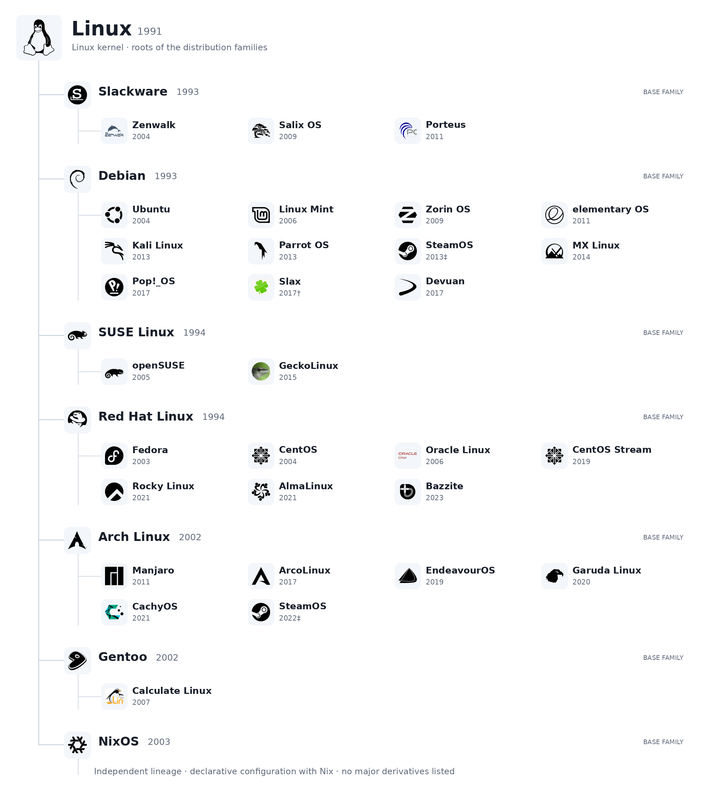

# Linux Distributions

A Linux distribution (distro) is a complete operating system built around the Linux kernel. Each distribution bundles a selected set of software components into a ready-to-use system. A typical distribution includes:

- **Linux Kernel** — the core of the operating system, managing hardware and system processes
- **System Utilities** — basic tools for managing the system, such as shell commands
- **Software Packages** — applications and libraries, including web browsers, text editors, and office suites
- **Package Manager** — a tool for installing, updating, and removing software
- **User Interface** — either a command-line interface (CLI) or a graphical user interface (GUI)

## Base Distributions

A base distribution is a Linux distribution built independently from the ground up — with its own package manager, package format, and release infrastructure. Unlike derivative distributions, which build on top of an existing distro, base distributions define the foundational toolchain and conventions that an entire family of downstream distros inherits.

| Distribution  | Year | Package Manager    | Package Format  | Release Model         | Philosophy |
|---------------|------|--------------------|-----------------|-----------------------|------------|
| Slackware     | 1993 | pkgtools           | TXZ             | Stable (versioned)    | KISS, UNIX-like simplicity |
| Debian        | 1993 | APT                | DEB             | Stable (freeze-based) | Community-driven, free software |
| SUSE Linux    | 1994 | Zypper             | RPM             | Stable (versioned)    | Enterprise focus, YaST integration |
| Red Hat Linux | 1994 | DNF (formerly YUM) | RPM             | Stable (versioned)    | Enterprise support, open-source innovation |
| Arch Linux    | 2002 | Pacman             | pkg.tar.zst     | Rolling release       | KISS, user-centric, minimal patching |
| Gentoo        | 2002 | Portage (emerge)   | Source (ebuild) | Rolling release       | Source-based, maximum flexibility |
| NixOS         | 2003 | Nix                | Nix store paths | Stable (versioned)    | Declarative, reproducible, functional |

### Slackware

Created by Patrick Volkerding in July 1993, Slackware is the oldest Linux distribution still actively maintained. Originally derived from Softlanding Linux System (SLS), it follows a **KISS** (Keep It Simple, Stupid) philosophy: minimal modifications to upstream software, text-file configuration, no automatic dependency resolution, and no GUI administration tools. Slackware aims to be the most UNIX-like Linux distribution, prioritizing stability and predictability over convenience. Its conservative design appeals to experienced users who prefer full control over their systems.

### Debian

Founded by Ian Murdock in August 1993, Debian was designed to be a high-quality, non-commercial distribution developed openly by its community — modeled after the collaborative development process of Linux itself. Its core innovation was the package system: the entire OS is divided into independently maintained packages, each knowing how to install, upgrade, and remove itself. This architecture, powered by `dpkg` and the **APT** package manager, became the foundation for the largest family of Linux distributions. Debian's strict quality standards, social contract, and commitment to free software have made it a trusted base for both servers and desktops.

### SUSE Linux

Founded in Nuremberg, Germany, in 1992 as S.u.S.E. (Software und System-Entwicklung), the company released its first Linux distribution in 1994, initially based on Slackware. SUSE developed **YaST** (Yet another Setup Tool), an integrated graphical installer and system-configuration framework that became its defining feature. In 2000, SUSE released the first enterprise Linux distribution (SLES for IBM S/390), and in 2005 it opened development to the community through the **openSUSE** project. SUSE remains a leading Linux distribution provider in enterprise environments, particularly in Europe.

### Red Hat Linux

Created by Marc Ewing in 1994, Red Hat Linux pioneered graphical configuration tools and introduced the **RPM** (Red Hat Package Manager) format — one of the two dominant Linux packaging standards alongside Debian's DEB. Bob Young joined Ewing in 1995 to form Red Hat Software, which grew into the first billion-dollar open-source company. In 2003, Red Hat split the distribution into two lines: **RHEL** for commercial customers with paid support, and **Fedora** as the community-driven, fast-moving successor. This model — a free community project feeding an enterprise product — has become a standard approach in the industry.

### Arch Linux

Created by Judd Vinet in March 2002, inspired by the minimalism of CRUX and frustration with Red Hat's upgrade procedures, Arch Linux follows the **KISS** principle: a minimal base system, no GUI installers, minimal patching of upstream software, and user-driven configuration through text files. Its **rolling-release** model means users install once and continuously update — there are no version upgrades. Arch's package manager, **Pacman**, provides binary package management with automatic dependency resolution, and the **Arch User Repository (AUR)** extends this with community-contributed build scripts for thousands of additional packages.

### Gentoo

Created by Daniel Robbins in 1999 (originally as Enoch, renamed Gentoo in 2000), with its first stable release in March 2002. Gentoo is a **source-based** distribution: instead of downloading precompiled binaries, its **Portage** package manager downloads source code and compiles it locally, allowing users to optimize software for their specific hardware. **USE flags** provide fine-grained control over which features are compiled into each package. Inspired by FreeBSD's ports system, Portage automates the entire build process — from downloading and patching to compilation and installation — while resolving dependencies automatically.

### NixOS

Built on the **Nix** package manager, which originated as a 2003 research project by Eelco Dolstra at Utrecht University. The first NixOS prototype was created by Armijn Hemel in 2006, with the first stable release in 2013. NixOS uses a **declarative configuration model**: the entire system — kernel, packages, services, and configuration — is defined in configuration files. Nix builds immutable, isolated packages in a content-addressed store, enabling **atomic upgrades**, instant **rollbacks**, and fully **reproducible** system configurations. This functional approach eliminates dependency conflicts and makes it possible to replicate an identical system on any machine from a single file.

## Derivative Distributions

Most Linux distributions are not built from scratch — they are derived from one of the base distributions above, inheriting its package manager, release model, and core infrastructure while adding their own customizations.

> **†** Slax was originally a Slackware derivative (2002) but was rebuilt on Debian starting with version 9.2.1 in 2017.
>
> **‡** SteamOS 1.0–2.0 (2013–2015) were Debian-based. SteamOS 3.0 (2022) switched to an Arch Linux base for the Steam Deck.

## Independent Distributions

Some distributions are built independently and do not belong to any of the families listed above:

| Distribution    | Year | Package Manager | Description |
|-----------------|------|-----------------|-------------|
| Puppy Linux     | 2003 | PPM             | Ultra-lightweight distribution designed for older hardware. |
| Alpine Linux    | 2005 | APK             | Minimal, security-focused distribution widely used in containers. |
| Void Linux      | 2008 | XBPS            | Lightweight distribution with its own package manager and init system (runit). |
| Tiny Core Linux | 2008 | tce-load        | Extremely small distribution (as little as 16 MB) for minimal hardware. |
| Clear Linux     | 2015 | Swupd           | Performance-optimized distribution by Intel; discontinued July 2025. |

## Distributions by Category

The tables below organize selected distributions by their primary use case. Some distributions appear in multiple contexts — for example, Arch Linux is both a base distribution and an advanced-user distribution.

### General-Purpose Desktop

Distributions designed for everyday desktop use, offering graphical interfaces and broad hardware support.

| Distribution  | Year | Base    | Description |
|---------------|------|---------|-------------|
| Fedora        | 2003 | Red Hat | Cutting-edge features, ideal for developers and technology enthusiasts. |
| Ubuntu        | 2004 | Debian  | User-friendly and widely adopted, popular with beginners and professionals alike. |
| openSUSE      | 2005 | SUSE    | Versatile and stable, with strong community and enterprise backing. |
| Linux Mint    | 2006 | Debian  | Familiar desktop experience, designed for users transitioning from Windows. |
| elementary OS | 2011 | Debian  | Clean, macOS-inspired design focused on simplicity and elegance. |
| Manjaro       | 2011 | Arch    | Accessible Arch-based distribution with user-friendly defaults. |
| MX Linux      | 2014 | Debian  | Lightweight and stable, designed for reliability on modest hardware. |

### Enterprise and Server

Distributions built for production servers, data centers, and enterprise workloads, emphasizing stability, security, and long-term support.

| Distribution                    | Year | Base    | Description |
|---------------------------------|------|---------|-------------|
| SUSE Linux Enterprise (SLES)   | 2000 | SUSE    | Reliable and scalable for enterprise environments and servers. |
| Red Hat Enterprise Linux (RHEL) | 2002 | Red Hat | Industry-standard enterprise distribution with commercial support. |
| CentOS                          | 2004 | Red Hat | Free RHEL rebuild; discontinued in 2021, replaced by CentOS Stream. |
| Oracle Linux                    | 2006 | Red Hat | Enterprise-focused, optimized for Oracle software and cloud environments. |
| Rocky Linux                     | 2021 | Red Hat | Community-driven, RHEL-compatible replacement for CentOS. |
| AlmaLinux                       | 2021 | Red Hat | Stable, RHEL-compatible alternative for enterprise servers. |

### Security and Penetration Testing

Distributions tailored for cybersecurity professionals, preloaded with tools for penetration testing, forensics, and vulnerability analysis.

| Distribution | Year | Base   | Description |
|-------------|------|--------|-------------|
| Kali Linux  | 2013 | Debian | Industry-standard platform for penetration testing and ethical hacking. |
| Parrot OS   | 2013 | Debian | Security and digital forensics platform with a lightweight desktop. |

### Lightweight and Minimal

Distributions optimized for low-resource hardware, embedded systems, or portable use, with small footprints and minimal dependencies.

| Distribution    | Year | Base        | Description |
|-----------------|------|-------------|-------------|
| Slax            | 2002 | Debian      | Lightweight and portable, can run directly from a USB drive. |
| Puppy Linux     | 2003 | Independent | Ultra-lightweight, designed for older hardware with limited resources. |
| Alpine Linux    | 2005 | Independent | Minimal and security-focused, widely used in Docker containers. |
| Void Linux      | 2008 | Independent | Lightweight and minimalist with its own package manager (XBPS). |
| Tiny Core Linux | 2008 | Independent | Extremely small and modular, ideal for minimal hardware. |
| Devuan          | 2017 | Debian      | Systemd-free Debian fork focused on init freedom and simplicity. |

### Advanced and Customizable

Distributions that prioritize flexibility and user control, suited for experienced users who prefer to build their system from the ground up.

| Distribution    | Year | Base   | Description |
|-----------------|------|--------|-------------|
| Arch Linux      | 2002 | —      | Highly customizable with manual setup and rolling-release updates. |
| Gentoo          | 2002 | —      | Source-based distribution offering maximum compile-time optimization. |
| Calculate Linux | 2007 | Gentoo | Pre-configured Gentoo-based distribution with ready-to-use desktops. |
| EndeavourOS     | 2019 | Arch   | User-friendly Arch-based alternative with a guided installer. |

## Code Names

Code names are memorable labels assigned to distribution releases, making them easier to identify than version numbers alone. The Linux kernel does **not** use code names — it uses the version numbering system described in the [Version Numbering](03_linux_kernel.md#version-numbering) section.

- **Debian** uses characters from the movie *Toy Story* (e.g., Buzz, Woody, Bookworm).
- **Ubuntu** uses alphabetical, alliterative animal names (e.g., Focal Fossa for 20.04, Jammy Jellyfish for 22.04).

## `/etc/os-release`

`/etc/os-release` is a standardized text file found on most modern Linux distributions that provides machine-readable metadata about the operating system. It contains key-value pairs such as:

| Key           | Description |
|---------------|-------------|
| `PRETTY_NAME` | A user-friendly name combining `NAME` and `VERSION`. |
| `NAME`        | The full name of the operating system. |
| `ID`          | A lowercase identifier for the OS (e.g., `ubuntu`, `fedora`). |
| `VERSION_ID`  | The numeric version of the OS. |
| `VERSION`     | A human-readable version string. |
| `ID_LIKE`     | Related OS families (e.g., `debian` for Ubuntu). |
| `HOME_URL`    | The official website of the distribution. |

This file is useful for scripts and tools that need to identify the Linux distribution and version in a standardized, portable way.

## Distribution-Specific Kernels

Linux distributions ship customized versions of the Linux kernel tailored to their target audience. Most general-purpose distributions, like Ubuntu and Fedora, ship the latest stable kernel. Enterprise distributions, such as RHEL and Debian Stable, prioritize long-term support (LTS) kernels for extended maintenance and reliability.

These distribution-specific kernels include additional patches, drivers, security enhancements, and optimizations not present in the mainline kernel. They are designed to integrate seamlessly with the distribution's package management system and default configurations.

For example, Ubuntu 20.04 LTS ships with the Linux kernel `5.4.0-26-generic`. Here, `5.4.0` denotes the upstream version, and `-26-generic` specifies Ubuntu's custom patches and configuration.

Use the `uname -r` command to check the running kernel version:

    $ uname -r
    5.15.0-127-generic

### Debian Kernel Versions

| Release     | Codename | Release Date  | Kernel Version |
|-------------|----------|---------------|----------------|
| Debian 6.0  | Squeeze  | February 2011 | 2.6.32 |
| Debian 7.0  | Wheezy   | May 2013      | 3.2 |
| Debian 8.0  | Jessie   | April 2015    | 3.16 |
| Debian 9.0  | Stretch  | June 2017     | 4.9 |
| Debian 10.0 | Buster   | July 2019     | 4.19 |
| Debian 11.0 | Bullseye | August 2021   | 5.10 |
| Debian 12.0 | Bookworm | June 2023     | 6.1 |
| Debian 13.0 | Trixie   | August 2025   | 6.12 |

### Ubuntu Kernel Versions

| Release          | Codename         | Release Date | Kernel Version |
|------------------|------------------|--------------|----------------|
| Ubuntu 14.04 LTS | Trusty Tahr      | April 2014   | 3.13 |
| Ubuntu 16.04 LTS | Xenial Xerus     | April 2016   | 4.4 |
| Ubuntu 18.04 LTS | Bionic Beaver    | April 2018   | 4.15 |
| Ubuntu 20.04 LTS | Focal Fossa      | April 2020   | 5.4 |
| Ubuntu 22.04 LTS | Jammy Jellyfish  | April 2022   | 5.15 |
| Ubuntu 24.04 LTS | Noble Numbat     | April 2024   | 6.8 |
| Ubuntu 26.04 LTS | Resolute Raccoon | April 2026   | 7.0 |

### RHEL Kernel Versions

| Release   | Release Date  | Kernel Version |
|-----------|---------------|----------------|
| RHEL 6.0  | November 2010 | 2.6.32-71 |
| RHEL 7.0  | June 2014     | 3.10.0-123 |
| RHEL 8.0  | May 2019      | 4.18.0-80 |
| RHEL 9.0  | May 2022      | 5.14.0-70 |
| RHEL 10.0 | May 2025      | 6.12.0-55 |

---

[← Previous: Linux Kernel](03_linux_kernel.md) | [Next: Linux System →](05_linux_system.md)
