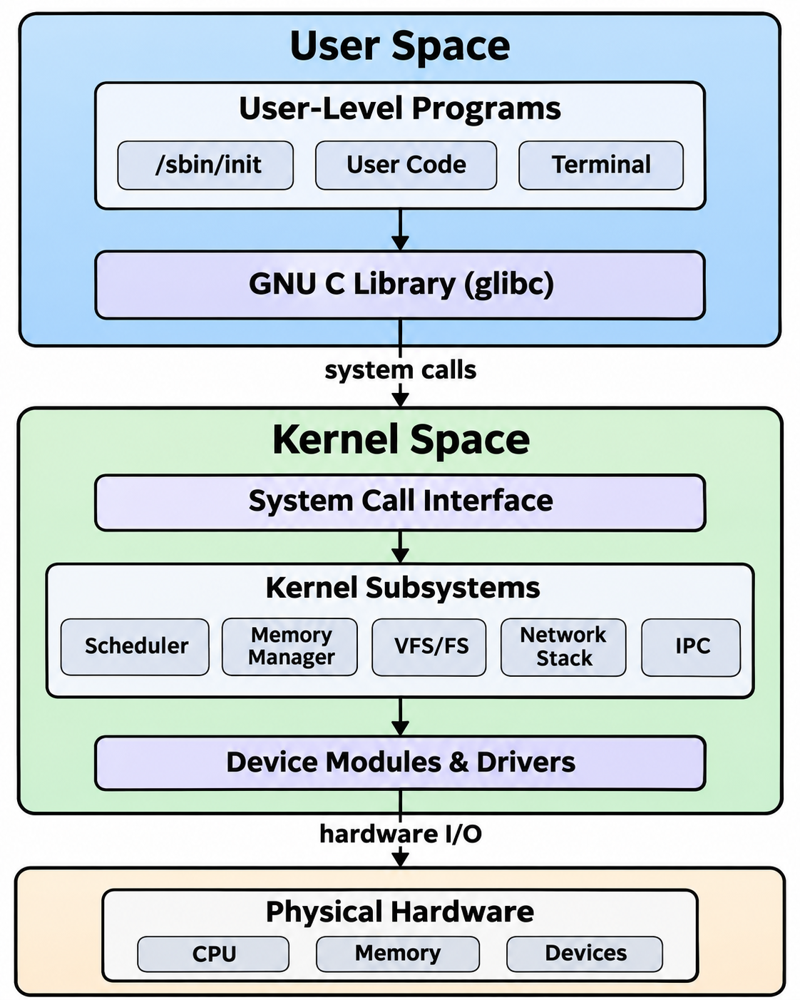

# Linux System

A Linux system is an operating system built around the Linux kernel — the core component that manages hardware resources and system processes. This chapter covers the system's internal architecture: the separation between kernel and user space, the kernel's major subsystems, how applications interact with the kernel through system calls, and how device drivers connect software to hardware.

## Kernel vs. User Space

Kernel space and user space are two distinct memory regions in a Linux system. They define where code executes and what resources it can access.

**Kernel space** is the privileged region where the kernel runs. Code executing here has unrestricted access to hardware and system resources, and performs core tasks such as hardware management, process scheduling, and memory allocation.

**User space** is the restricted region where regular applications run. Programs in user space cannot access hardware directly — they must request services from the kernel through system calls.

This separation protects system stability and security by isolating critical kernel operations from application-level errors.



## Kernel Subsystems

The diagram above shows the major kernel subsystems — specialized components within the kernel, each responsible for managing a specific aspect of system functionality:

- **Process Scheduler** — allocates CPU time to running processes, ensuring fair and efficient CPU usage
- **Memory Manager** — handles RAM allocation, virtual memory, and page management
- **Virtual File System (VFS) / File System** — provides a unified interface for data storage and retrieval across different file system types
- **Network Stack** — handles network protocols and data transmission
- **Inter-Process Communication (IPC)** — enables communication between processes through mechanisms such as pipes, message queues, shared memory, and signals

These subsystems work together to provide the low-level services that applications depend on.

## System Calls

A system call is the mechanism that allows user-space applications to request services from the kernel. Since user-space programs cannot access hardware or kernel resources directly, system calls provide a controlled gateway between the two.

As shown in the diagram above, making a system call involves two components on opposite sides of the boundary:

**GNU C Library (glibc)** — the user-space side. When a program calls a C function like `read()`, `write()`, or `open()`, glibc translates that function call into the kernel's system call convention: it places the system call number and arguments into the correct CPU registers, then executes the `syscall` instruction to trigger a transition into kernel mode. When the kernel returns a result, glibc converts any error codes and passes the result back to the program.

**System Call Interface** — the kernel-space side. This is the kernel entry point that receives control after the CPU switches to kernel mode. It reads the system call number, dispatches it to the appropriate kernel handler (e.g., `sys_read`, `sys_write`), and returns the result to user space.

Together, these two layers form the bridge between applications and the kernel. Most programs never interact with the system call interface directly — they call glibc functions, which handle the low-level details transparently. The following examples show different ways to invoke system calls, from the most common high-level approach to the lowest-level direct invocation.

> For a comprehensive reference of system calls organized by category, see [System Calls](06_system_calls.md).

### Standard Library Wrappers

The most common way to make system calls is through standard library functions. In C, the `read` function in `<unistd.h>` is a glibc wrapper around the `read` system call:

```c
#include <unistd.h>

int main() {
    char buffer[128];
    ssize_t bytes_read = read(0, buffer, 128); // read up to 128 bytes from stdin
    return 0;
}
```

In Python, the `os.read` function wraps the same system call:

```python
import os

buffer = os.read(0, 128)  # read up to 128 bytes from stdin
```

### Foreign Function Interfaces (FFI)

Higher-level languages like Python, Ruby, or JavaScript can invoke system calls through FFI bindings. These interfaces call C library functions, which in turn invoke the underlying system calls:

```python
import ctypes

libc = ctypes.CDLL(None)               # load the C library
libc.write(1, b"Hello, World!\n", 14)   # write to stdout
```

### Languages with Built-in System Call Support

Some languages provide direct access to system calls as part of their standard library, without requiring C wrappers or FFI. For example, Go's `syscall` package and Rust's `libc` crate allow invoking system calls natively:

```go
package main

import "syscall"

func main() {
    syscall.Write(1, []byte("Hello, World!\n"))
}
```

### Direct Invocation via Inline Assembly

For the lowest level of control, system calls can be invoked directly using assembly language, bypassing glibc entirely. On x86-64 Linux, this requires placing the system call number in `%rax`, arguments in `%rdi`, `%rsi`, `%rdx`, `%r10`, `%r8`, and `%r9`, then issuing the `syscall` instruction. The return value is placed in `%rax`.

For example, making a `write` system call (number 1) to print a string to standard output:

```asm
mov $1, %rax        # system call number (1 = write)
mov $1, %rdi        # first argument: file descriptor (1 = stdout)
mov $msg, %rsi      # second argument: address of the string
mov $len, %rdx      # third argument: length of the string
syscall             # invoke the system call
```

## Device Drivers

A device driver is kernel software that enables communication between the operating system and a hardware device. As shown at the bottom of the architecture diagram, drivers sit between the kernel subsystems and the physical hardware, translating high-level kernel requests into device-specific operations.

Device drivers fall into two categories based on how they are integrated with the kernel:

**Built-in drivers** are compiled directly into the kernel binary image. They are available immediately at boot time and are typically used for essential hardware that the system cannot start without, such as the root filesystem's disk controller.

**Loadable modules** are compiled as separate kernel modules (`.ko` files) that can be inserted or removed at runtime using commands like `insmod` and `rmmod`. This allows managing drivers for optional or peripheral hardware — such as USB devices or specialized network adapters — without rebuilding the kernel or rebooting the system.

During a Linux kernel build, you choose whether to include each driver directly in the kernel binary or build it as a loadable module. This choice is made in the kernel configuration stage (e.g., using `make menuconfig`), where each driver option is marked as built-in (`[*]`), module (`[M]`), or excluded (`[ ]`).

---

[← Previous: Linux Distributions](04_linux_distributions.md) | [Next: System Calls →](06_system_calls.md)
