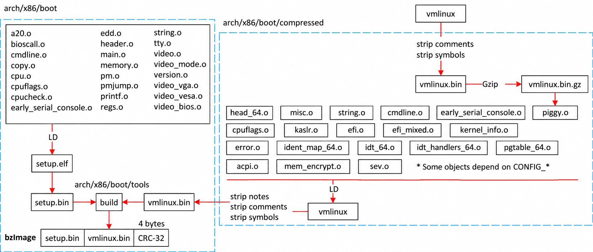

# Compiling the Linux Kernel for x86

This chapter walks through configuring and compiling a Linux kernel for x86 inside a Docker container. Docker provides a consistent, isolated build environment so dependencies and tools do not conflict with the host system.

## Prepare Docker Container

Pull and run an Ubuntu 24.04 container:

```
$ docker pull ubuntu:24.04
$ docker run -d -it --name kernel-x86 --hostname kernel-x86 ubuntu:24.04
$ docker exec -it kernel-x86 /bin/bash
```

Install the required build dependencies:

```
$ apt update
$ DEBIAN_FRONTEND=noninteractive apt install -y \
    build-essential \
    bison \
    flex \
    libncurses-dev \
    libssl-dev \
    libelf-dev \
    bc \
    kmod \
    cpio \
    xz-utils \
    pkg-config \
    wget \
    git \
    file \
    python3
```

| Package | Purpose |
|---------|---------|
| `build-essential` | GCC, Make, and core build tools |
| `bison` | Parser generator required by the kernel build system |
| `flex` | Lexical analyzer required by the kernel build system |
| `libncurses-dev` | Terminal UI libraries for `menuconfig` |
| `libssl-dev` | Module signing and certificate handling |
| `libelf-dev` | ELF handling for objtool, BPF, and BTF |
| `bc` | Calculator used by kernel build scripts |
| `kmod` | Module tools (`depmod`, `modprobe`) |
| `cpio` | Building initramfs images |
| `xz-utils` | Extracting `.tar.xz` archives |
| `pkg-config` | Resolving library dependencies at build time |
| `wget` | Downloading the kernel source tarball |
| `git` | Cloning the kernel Git repository |
| `file` | Identifying file types (used to verify kernel images) |
| `python3` | Used by some driver build scripts (e.g., DRM/GPU header generation) |

## Download Kernel Source Code

`/usr/src` is the conventional location for kernel source on Linux systems. Download and extract Linux 6.12:

```
$ cd /usr/src
$ wget https://www.kernel.org/pub/linux/kernel/v6.x/linux-6.12.tar.xz
$ tar -xf linux-6.12.tar.xz
$ cd linux-6.12
```

> For other ways to obtain the source (Git, signature verification), see [Kernel Source](07_kernel_source.md).

## Configure the Kernel

Before compiling, you choose which features to include — drivers, filesystems, networking, security options, and more. That selection is stored in a file named `.config` at the root of the source tree. The build system reads `.config` and compiles only what you selected. The source tree does not ship with a `.config`; you must create one first.

### The .config File

`.config` is a plain-text file with one line per option:

```
CONFIG_SMP=y
CONFIG_EXT4_FS=m
# CONFIG_DEBUG_INFO is not set
```

Most options are **tristate** — they accept one of three values:

| Value | Meaning |
|-------|---------|
| **N** (No) | Feature is left out of the build |
| **Y** (Yes) | Feature is built into the kernel image |
| **M** (Module) | Feature is built as a loadable module (`.ko`) |

Built-in features (`Y`) are available as soon as the kernel starts. Modules (`M`) live as separate files on disk and are loaded later with `modprobe` or `insmod`.

> **Important:** Drivers needed during early boot — such as the root filesystem driver — must be built-in (`Y`) or placed in the initramfs. If a required driver is only a module sitting on the root filesystem, the kernel cannot load it before that filesystem is mounted, and boot fails.

### Default Configs

Architecture-specific defaults live under:

```
arch/<arch>/configs/
```

For x86_64, the baseline is [arch/x86/configs/x86_64_defconfig](https://github.com/torvalds/linux/blob/master/arch/x86/configs/x86_64_defconfig). Running `make defconfig` reads the right file for your architecture and writes a `.config`. These defaults enable common hardware and features, so most users only need small changes on top.

### Generate a Config

Create a baseline configuration, then optionally customize it:

```
$ make defconfig
$ make menuconfig
```

`menuconfig` opens a terminal menu where you can search, enable, disable, or change options. Save and exit when finished. If you are fine with the defaults, you can skip `menuconfig` and go straight to the build.

### Configuration Tools

The kernel provides many targets for creating or updating `.config`. Run `make help` for the full list. Common groups:

| Category | Targets |
|----------|---------|
| Text-based UIs | `menuconfig`, `nconfig` (ncurses) |
| Graphical UIs | `xconfig` (Qt), `gconfig` (GTK+) |
| Command-line | `config`, `oldconfig`, `olddefconfig` |
| Defaults | `defconfig`, `savedefconfig`, `alldefconfig` |
| Minimal / specialized | `tinyconfig`, `localmodconfig`, `localyesconfig` |
| Automated | `allnoconfig`, `allyesconfig`, `allmodconfig`, `randconfig` |
| Module conversion | `yes2modconfig`, `mod2yesconfig`, `mod2noconfig` |
| Inspection | `listnewconfig`, `helpnewconfig`, `testconfig` |
| Topic configs | `debug.config`, `hardening.config`, `kvm_guest.config`, `rust.config`, `xen.config` |

- **Text / graphical UIs** — browse options interactively. `menuconfig` is the usual choice in a terminal; graphical tools need Qt or GTK+.
- **Command-line** — `oldconfig` prompts only for options missing from an existing `.config`; `olddefconfig` accepts defaults for those without prompting (useful in scripts).
- **Defaults** — `defconfig` loads the architecture default; `savedefconfig` writes a minimal defconfig from the current config.
- **Minimal / specialized** — `tinyconfig` aims for the smallest kernel; `localmodconfig` keeps only modules currently loaded on the running system; `localyesconfig` does the same but builds them in.
- **Automated** — bulk configs for testing (`allyesconfig`, `allmodconfig`, `allnoconfig`, `randconfig`).
- **Module conversion** — flip groups of options between built-in (`Y`) and module (`M`), or disable modules.
- **Inspection** — list or explain options that are new since the last config update.
- **Topic configs** — fragments under `kernel/configs/` that enable a related set of options. Merge them onto an existing `.config` with `scripts/kconfig/merge_config.sh` (for example `hardening.config` or `kvm_guest.config`).

## Compile the Kernel

With `.config` in place from `make defconfig` (and optional `make menuconfig`), build using all available CPU cores (`nproc` prints the core count; `-j` runs that many parallel jobs):

```
$ make -j$(nproc)
```

When the build finishes, you should see:

```
  OBJCOPY arch/x86/boot/vmlinux.bin
  AS      arch/x86/boot/header.o
  LD      arch/x86/boot/setup.elf
  OBJCOPY arch/x86/boot/setup.bin
  BUILD   arch/x86/boot/bzImage
Kernel: arch/x86/boot/bzImage is ready  (#1)
```

Verify the image:

```
$ file arch/x86/boot/bzImage
arch/x86/boot/bzImage: Linux kernel x86 boot executable bzImage, version 6.12.0 ...
```

## How bzImage Is Created

`bzImage` is produced from `vmlinux` — the uncompressed ELF kernel binary in the source root. `vmlinux` keeps full symbols and debug info, so it is useful with tools like `gdb`.



The build pipeline:

**1. Strip symbols** — strip debug symbols and notes from `vmlinux` to produce the raw binary `vmlinux.bin`.

**2. Compress** — compress `vmlinux.bin` (gzip, bzip2, LZMA, or another configured algorithm) to produce something like `vmlinux.bin.gz`.

**3. Link with decompression stub** — embed the compressed payload (as `piggy.o`) into a small program (`head_64.o`, `misc.o`, and related objects) that can decompress and start the kernel. Source lives under:

```
arch/x86/boot/compressed/
```

Entry point: [arch/x86/boot/compressed/head_64.S](https://github.com/torvalds/linux/blob/v6.12/arch/x86/boot/compressed/head_64.S)

**4. Build real-mode setup code** — link real-mode objects (`a20.o`, `bioscall.o`, `main.o`, `header.o`, and others) into `setup.elf`, then convert to `setup.bin`. This is the first code that runs after a traditional BIOS bootloader hands off control.

**5. Assemble bzImage** — the `build` tool concatenates `setup.bin`, the compressed kernel (with its decompression stub), and a 4-byte CRC-32 checksum into the final `bzImage`.

### Boot-time Execution

On a traditional BIOS boot, the bootloader loads `bzImage` into memory and jumps to `setup.bin`:

1. `setup.bin` queries the BIOS for hardware information (memory map, video modes, disk geometry)
2. Enables the A20 line and loads a GDT so the CPU can leave 16-bit real mode and enter protected mode
3. Jumps to the decompression stub, which unpacks the kernel into its final location
4. The stub checks the embedded CRC-32; on failure, boot stops with `CRC Error: System Halted`
5. Control passes to the uncompressed kernel entry point

> For the full sequence after the kernel takes control, see [Kernel Boot Process](13_kernel_boot.md).

---

[← Previous: Kernel Image](08_kernel_image.md) | [Next: Compiling for ARM32 →](10_compiling_arm32.md)
