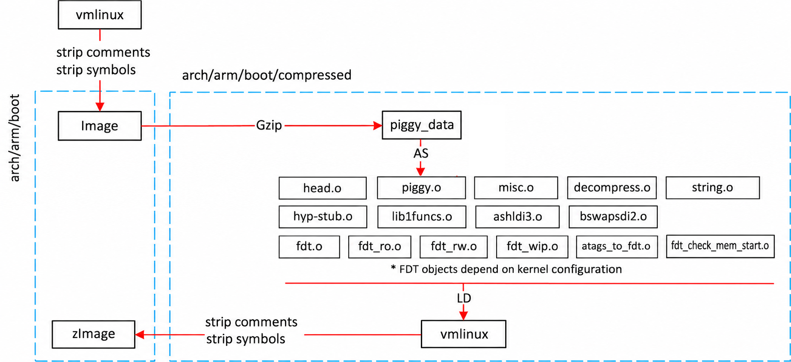

# Compiling the Linux Kernel for ARM 32-bit

This chapter walks through cross-compiling the Linux kernel for ARM 32-bit on an x86 machine using Docker.

Compiling the kernel natively on ARM hardware (e.g., a Raspberry Pi) is straightforward but slow — a full build can take over an hour on a typical ARM board due to limited CPU cores, memory, and storage speed. Cross-compilation runs the same compiler work on a more powerful x86 host, where faster CPUs, more RAM, and SSD storage cut build times dramatically. The compiler itself does nearly identical work regardless of target architecture; what changes is only the final instruction-selection stage.

## Prepare Docker Container

Pull and run an Ubuntu 24.04 container:

```
$ docker pull ubuntu:24.04
$ docker run -d -it --name kernel-arm32 --hostname kernel-arm32 ubuntu:24.04
$ docker exec -it kernel-arm32 /bin/bash
```

Install the same base packages listed in [Compiling for x86](09_compiling_x86.md), plus the ARM 32-bit cross compiler:

```
$ apt update

$ DEBIAN_FRONTEND=noninteractive apt install -y \
    build-essential \
    bison \
    flex \
    libncurses-dev \
    libssl-dev \
    libelf-dev \
    bc \
    kmod \
    cpio \
    xz-utils \
    pkg-config \
    wget \
    git \
    file \
    python3 \
    gcc-arm-linux-gnueabihf
```

The only new package is `gcc-arm-linux-gnueabihf` — the ARM 32-bit cross compiler with hard-float ABI. See [Compiling for x86 – Prepare Docker Container](09_compiling_x86.md#prepare-docker-container) for what each base package does.

## Download Kernel Source Code

```
$ cd /usr/src
$ wget https://www.kernel.org/pub/linux/kernel/v6.x/linux-6.12.tar.xz
$ tar -xf linux-6.12.tar.xz
$ cd linux-6.12
```

## Configure the Kernel for ARM 32-bit

When cross-compiling, you must set two environment variables so the build system uses the correct compiler and architecture:

```
$ export ARCH=arm
$ export CROSS_COMPILE=arm-linux-gnueabihf-
```

- `ARCH` tells the build system to use ARM Kconfig files, default configs, and boot image rules.
- `CROSS_COMPILE` is the prefix for the cross toolchain. The build system appends tool names (`gcc`, `ld`, `objcopy`, etc.) to this prefix — note the **trailing dash**.

The kernel includes board-specific default configurations under:

```
arch/arm/configs/
```

For example, `make vexpress_defconfig` loads defaults for a Versatile Express board. To start with a general default and customize interactively:

```
$ make defconfig
$ make menuconfig
```

> For a detailed explanation of `.config`, see [Compiling for x86 – Configure the Kernel](09_compiling_x86.md#configure-the-kernel).

## Compile the Kernel

With `.config` in place, build using all available CPU cores:

```
$ make -j$(nproc)
```

The build produces `zImage` — the compressed, bootable kernel image for ARM 32-bit:

```
$ file arch/arm/boot/zImage
arch/arm/boot/zImage: Linux kernel ARM boot executable zImage (little-endian)
```

## How zImage Is Created

`zImage` is created from `vmlinux` — the uncompressed ELF kernel binary produced during the build.



The build pipeline:

**1. Strip symbols** — `objcopy` strips ELF headers, debug symbols, and notes from `vmlinux` to produce a raw binary called `Image`.

**2. Compress** — `Image` is compressed using gzip (or another configured compressor), producing `piggy_data`. The compressed data is wrapped in `piggy.S`, an assembly source file that records the size and location of the compressed payload, and assembled into `piggy.o`.

**3. Link with decompression stub** — `piggy.o` is linked with `head.o`, `misc.o`, `decompress.o`, and other support objects (including FDT helpers for device tree handling) into `arch/arm/boot/compressed/vmlinux` — a self-contained executable that can decompress and launch the kernel. The decompression entry point is:

Source: [arch/arm/boot/compressed/head.S](https://github.com/torvalds/linux/blob/v6.12/arch/arm/boot/compressed/head.S)

**4. Produce zImage** — `objcopy` strips the remaining symbols from the linked result, producing the final self-extracting, bootable kernel image.

> **zImage vs. bzImage:** Both are compressed, self-extracting kernel images. `bzImage` ("big zImage") is the x86 format — the "big" refers to its ability to load into high memory (above 1 MB), overcoming the 640 KB real-mode limit of the original x86 `zImage`. ARM's `zImage` does not have this limitation; ARM bootloaders can place the kernel at any address in physical memory.

## uImage

A uImage is a kernel image format used by **U-Boot**, a popular bootloader for embedded systems. It is created using the `mkimage` tool, which prepends a 64-byte header containing metadata that U-Boot uses to validate and load the image.

### uImage Header Format

| **Offset** | **Field** | **Size** | **Description** |
|-----------|----------|---------|-----------------|
| 0 | Magic Number | 4 bytes | Identifies the image format (always `0x27051956`). |
| 4 | Header CRC | 4 bytes | CRC32 checksum of the header. |
| 8 | Timestamp | 4 bytes | UNIX timestamp of image creation. |
| 12 | Image Size | 4 bytes | Size of the image data (excluding header). |
| 16 | Load Address | 4 bytes | Memory address where the image should be loaded. |
| 20 | Entry Point | 4 bytes | Address where execution begins after loading. |
| 24 | Data CRC | 4 bytes | CRC32 checksum of the image data. |
| 28 | OS Type | 1 byte | Operating system (e.g., Linux = 5). |
| 29 | CPU Architecture | 1 byte | Target architecture (e.g., ARM = 2). |
| 30 | Image Type | 1 byte | Type of image (e.g., kernel, RAM disk). |
| 31 | Compression Type | 1 byte | Compression algorithm (e.g., Gzip = 1). |
| 32 | Image Name | 32 bytes | Null-terminated ASCII description. |

### Generating uImage

Install U-Boot tools if not already installed:

```
$ apt install u-boot-tools
```

Build a uImage directly from the kernel source:

```
$ make uImage LOADADDR=0x00008000
```

`LOADADDR` specifies the memory address where the kernel image will be loaded into RAM. It must match the memory layout of your target board and is typically found in the board documentation or U-Boot configuration.

Under the hood, `make uImage` calls `mkimage` to convert the zImage:

```
$ mkimage -A arm -O linux -T kernel -C none -a 0x00008000 -e 0x00008000 \
    -n 'Linux-6.12' -d arch/arm/boot/zImage arch/arm/boot/uImage
```

The `-C none` flag tells U-Boot that the payload is not compressed at the uImage level. Although the zImage is internally compressed, U-Boot does not need to decompress it — the kernel's built-in decompression stub handles that after being loaded into memory.

Verify the uImage:

```
$ mkimage -l arch/arm/boot/uImage

Image Name:   Linux-6.12
Created:      Wed Jan  1 19:31:42 2025
Image Type:   ARM Linux Kernel Image (uncompressed)
Data Size:    9896448 Bytes = 9664.50 KiB = 9.44 MiB
Load Address: 00008000
Entry Point:  00008000
```

---

[← Previous: Compiling for x86](09_compiling_x86.md) | [Next: Compiling for ARM64 →](11_compiling_arm64.md)
